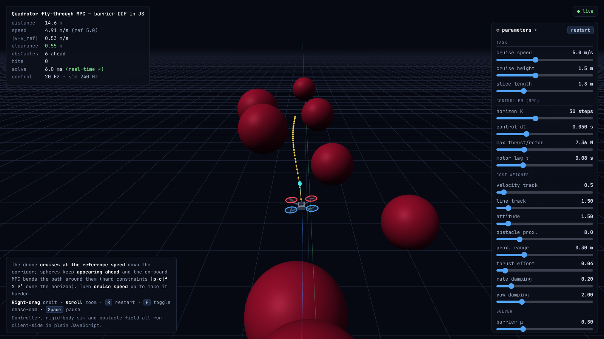

# Quadrotor fly-through MPC

A real-time 3D simulation of a quadrotor flying down a corridor while obstacles keep appearing ahead of it. A model predictive controller (MPC) replans the next 1.5 seconds of flight 20 times per second and steers around every sphere. The flight dynamics, the controller and the 3D view all run in the browser, with no server and no build step.

**Live demo:** the website link at the top of this repository (About panel). You can also download `index.html` and open it in any modern browser.

## What you are looking at

| Colour | Meaning |
| --- | --- |
| Yellow line with dots | The path the controller plans to fly, one dot per control step |
| Cyan arrow | Current velocity |
| Blue line | Path already flown |
| Green line | Corridor centre at cruise height (the reference) |
| Red spheres | Obstacles; they flash if touched |
| Red / blue rotors | Front / rear of the drone |

The panel on the left shows live telemetry: distance flown, speed and its error from the reference, clearance to the nearest obstacle, collisions, and how long each MPC solve takes.

## How it works

**Drone model.** 17 states: position, velocity, attitude quaternion, body rates, and the four rotor thrusts, which follow their commands with a first-order motor lag. The inputs are the four commanded rotor thrusts. Mass 1.5 kg, arm length 0.2 m, quadratic air drag. The simulation integrates the model with RK4 at 240 Hz.

**Controller.** A receding-horizon optimal control problem (30 steps of 50 ms) solved with differential dynamic programming: iLQR with regularisation and a line search, warm-started from the previous solution. The cost tracks the cruise speed and the corridor centre line and penalises tilt, body rates and thrust effort.

**Constraints.** Enforced as hard limits with log barriers:

- distance to every sphere stays above its radius plus the drone's (|p − c|² ≥ r²), with spheres slightly inflated so the path between plan points clears them too
- tilt stays under 70° and altitude stays above the floor
- each rotor thrust stays between zero and its maximum

The line search never swaps a collision-free plan for one that collides.

## Results

From closed-loop runs on random obstacle fields:

- default settings (5 m/s): no collisions in six 60-second runs, about 1,300 obstacles
- no collisions at 6.5 and 8 m/s, with denser obstacles, weaker motors, or horizons from 15 to 60 steps
- around 11 m/s it starts clipping obstacles, the hard end of the speed slider
- 3–9 ms per solve, against a 50 ms control period

## Controls

| Action | Mouse and keyboard | Touch |
| --- | --- | --- |
| Orbit the camera | Drag (right or left button) | Drag |
| Zoom | Scroll | Pinch |
| Toggle the chase camera | F | Double-tap |
| Restart with new obstacles | R, or the restart button | Restart button |
| Pause or resume | Space, or the live button | Live button |

Every slider in the parameters panel takes effect immediately: the task (cruise speed, height, obstacle spacing), the controller (horizon length, control period, motor limits and lag), the cost weights, and the solver settings. Changed values turn blue; double-click a slider to reset it.

## Tech

Plain JavaScript in a single HTML file. [three.js](https://threejs.org) r128 draws the scene and loads from a CDN. The controller and the simulator use no numerical libraries.
